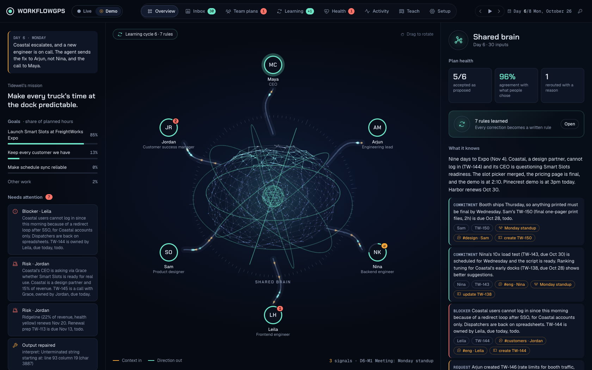
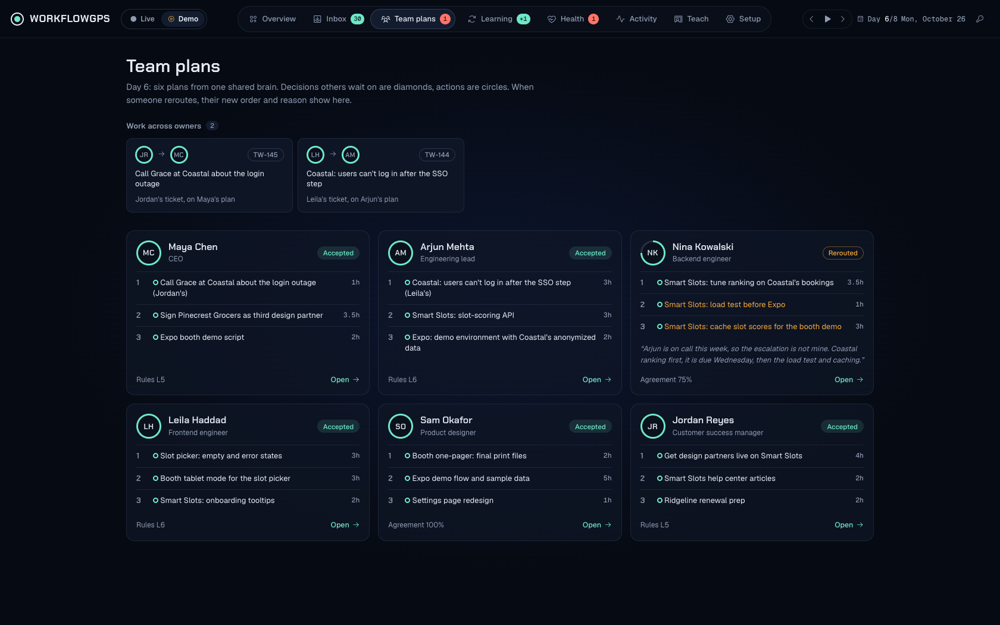
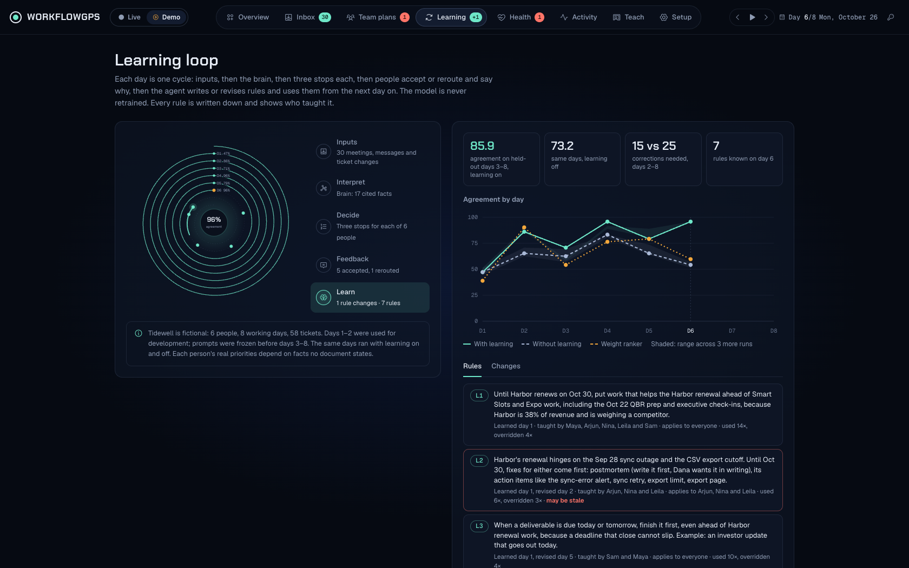
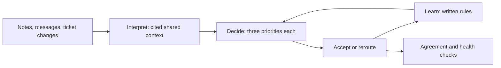

<div align="center">

# WorkflowGPS

### One shared direction. Three clear next steps.

A planning platform that turns scattered updates into daily priorities,
then learns from the decisions you make.

[Get started](#run-locally) · [Explore the platform](#inside-the-platform) · [How learning works](#the-learning-loop)

</div>



WorkflowGPS brings meeting notes, Slack messages, and ticket changes into one shared view. It connects daily work to your goals, proposes three priorities for each person, and keeps the reasoning attached to the plan. Accept the route or change it and explain why. Those corrections become written rules for the next day.

## Inside the platform

| View | What you can do |
| --- | --- |
| **Shared brain** | Explore the interactive 3D map, follow incoming context, inspect cited facts, and open individual plans. |
| **Inbox** | Paste meeting notes or transcripts, add messages, and record ticket changes. |
| **Daily plans** | Review three ordered stops with time boxes and sources. Accept, reorder, or swap work and give a reason. |
| **Learning** | See the rules learned from corrections, their revisions, and agreement over time. |
| **Health & activity** | Inspect rejected plans, agreement drops, repeated overrides, and the day's inputs. |
| **Setup** | Configure the workspace, import or export data, and load the sample dataset. |

### Daily priorities, with the reasoning attached



Each plan is a route through the day. Changes stay visible alongside the original proposal, so the reason for a different direction becomes useful context.

### A visible learning loop



*Screenshots show the included fictional Tidewell dataset in Demo mode.*

## Live and Demo

**Live** opens by default and saves your workspace locally in `workspaces/default/`. Configure six people, goals, customers, on-call coverage, and tickets. Add the day's inputs, generate plans, review them, then close the day to learn from corrections. The current planner requires exactly six people.

**Demo** replays eight recorded days without an API key. Use the header switch to explore plans, feedback, learned rules, health checks, and the comparison with learning disabled. The Teach view can also try a new correction; uncached model calls require a key.

## Run locally

```bash
git clone https://github.com/realjeffreyau/WorkflowGPS-AI-Agent.git
cd WorkflowGPS-AI-Agent
python3 -m venv .venv
source .venv/bin/activate
pip install -r requirements.txt
cp .env.example .env
python -m agent serve
```

Open **http://localhost:8000**. Switch to **Demo** to explore immediately.

For Live planning, set `ANTHROPIC_API_KEY` and a model available to your account in `.env`, then restart the server. OpenAI is also supported through `LLM_PROVIDER=openai`, `LLM_MODEL`, and `OPENAI_API_KEY`. Keep `.env` private.

Demo Teach uses a pasted key by default. To allow your local environment key, set `TEACH_USE_ENV_KEY=1`. When `PORT` is set, the server uses public mode: the workspace is disabled unless `ALLOW_WORKSPACE=1`, and the server's key is never used for model requests. This is a local workspace application; it has no user authentication or tenant isolation.

## The learning loop



Learning happens through explicit memory rather than model retraining. Interpret compacts context into at most 20 cited facts. Decide proposes priorities using that context and existing rules. After review, Learn turns corrections into rules that record who taught them.

Model outputs are validated against the input data. Failed validation gets one retry with the errors; truncated output stops the run. Calls are cached by prompt input for replay.

### Recorded evaluation

The included synthetic benchmark covers six people, eight days, and 58 tickets. Days 1–2 were used for development; prompts were frozen before held-out days 3–8. The same dataset was run with learning enabled and disabled.

| Metric | Learning off | Learning on |
| --- | ---: | ---: |
| Agreement, held-out days 3–8 | 73.2 | **85.9** |
| Corrections, days 2–8 | 25 | **15** |

Agreement measures overlap and ordering against the recorded choices, weighted by priority. These results demonstrate behavior on a fictional dataset, not outcomes from real customers. Rules can conflict or become stale; their history and overrides remain visible for review.

## Development

Python, Pydantic, Anthropic/OpenAI SDKs, and a standard-library HTTP server power the agent. The frontend uses plain HTML, CSS, JavaScript, and Three.js with no build step.

```bash
python -m agent validate
python -m pytest -q
```

| Path | Purpose |
| --- | --- |
| `agent/steps.py` · `prompts/` | Interpret, Decide, Learn, and output validation |
| `agent/workspace.py` | Local workspace state and daily workflow |
| `agent/view.py` | Shared data shape for Live and Demo |
| `agent/serve.py` | UI server and workspace API |
| `ui/` | Platform interface and exported replay data |
| `data/` · `runs/` | Synthetic inputs, recorded plans, rules, and scores |
| `baselines/ranker.py` | Weight-learning baseline |

The automated suite contains 31 tests. Live planning and learning require valid provider credentials; a real model-backed Live workspace run has not yet been verified.
